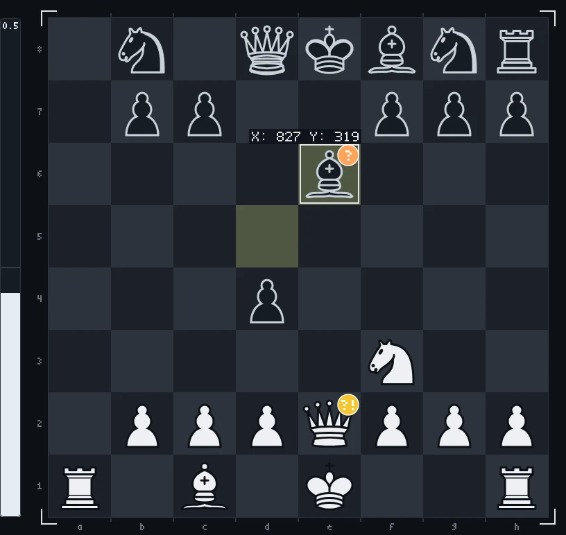

<!--
  Шапка рендерится canvas'ом офлайн (GitHub не исполняет JS в README):
    npm i
    npm run build        # render/game.mjs -> assets/chess-header.gif + assets/chess-header-static.png
  Спрайты фигур уже лежат в source/sprites/. Перерендерить их из 3D-модели
  (source/chess_set/, «Chess Set» с polyhaven.com/a/chess_set, CC0):
    npm run sprites      # и открыть http://localhost:5178
  Руки: source/gen/hand_{top,bottom,right}.png на зелёном фоне.
-->

<picture>
  <source media="(prefers-reduced-motion: reduce)" srcset="./assets/chess-header-static.png">
  
</picture>

<!-- chess:start -->

<a href="https://github.com/2md55nmxkw-arch">@2md55nmxkw-arch</a> <code>Qe2+</code>  inaccuracy · stockfish <code>Be6</code>  mistake

♔︎&nbsp; <a href="https://github.com/2md55nmxkw-arch/2md55nmxkw-arch/issues/new?title=chess%7Cmove%7Ce1d1&body=Just+press+**Create**%2C+stockfish+answers+and+the+board+on+the+profile+updates+in+about+a+minute.%0A%0APlease+don%27t+change+the+title.">Kd1</a> <a href="https://github.com/2md55nmxkw-arch/2md55nmxkw-arch/issues/new?title=chess%7Cmove%7Ce1f1&body=Just+press+**Create**%2C+stockfish+answers+and+the+board+on+the+profile+updates+in+about+a+minute.%0A%0APlease+don%27t+change+the+title.">Kf1</a> <a href="https://github.com/2md55nmxkw-arch/2md55nmxkw-arch/issues/new?title=chess%7Cmove%7Ce1g1&body=Just+press+**Create**%2C+stockfish+answers+and+the+board+on+the+profile+updates+in+about+a+minute.%0A%0APlease+don%27t+change+the+title.">O-O</a> 
♕︎&nbsp; <a href="https://github.com/2md55nmxkw-arch/2md55nmxkw-arch/issues/new?title=chess%7Cmove%7Ce2a6&body=Just+press+**Create**%2C+stockfish+answers+and+the+board+on+the+profile+updates+in+about+a+minute.%0A%0APlease+don%27t+change+the+title.">Qa6</a> <a href="https://github.com/2md55nmxkw-arch/2md55nmxkw-arch/issues/new?title=chess%7Cmove%7Ce2b5&body=Just+press+**Create**%2C+stockfish+answers+and+the+board+on+the+profile+updates+in+about+a+minute.%0A%0APlease+don%27t+change+the+title.">Qb5+</a> <a href="https://github.com/2md55nmxkw-arch/2md55nmxkw-arch/issues/new?title=chess%7Cmove%7Ce2c4&body=Just+press+**Create**%2C+stockfish+answers+and+the+board+on+the+profile+updates+in+about+a+minute.%0A%0APlease+don%27t+change+the+title.">Qc4</a> <a href="https://github.com/2md55nmxkw-arch/2md55nmxkw-arch/issues/new?title=chess%7Cmove%7Ce2d1&body=Just+press+**Create**%2C+stockfish+answers+and+the+board+on+the+profile+updates+in+about+a+minute.%0A%0APlease+don%27t+change+the+title.">Qd1</a> <a href="https://github.com/2md55nmxkw-arch/2md55nmxkw-arch/issues/new?title=chess%7Cmove%7Ce2d3&body=Just+press+**Create**%2C+stockfish+answers+and+the+board+on+the+profile+updates+in+about+a+minute.%0A%0APlease+don%27t+change+the+title.">Qd3</a> <a href="https://github.com/2md55nmxkw-arch/2md55nmxkw-arch/issues/new?title=chess%7Cmove%7Ce2e3&body=Just+press+**Create**%2C+stockfish+answers+and+the+board+on+the+profile+updates+in+about+a+minute.%0A%0APlease+don%27t+change+the+title.">Qe3</a> <a href="https://github.com/2md55nmxkw-arch/2md55nmxkw-arch/issues/new?title=chess%7Cmove%7Ce2e4&body=Just+press+**Create**%2C+stockfish+answers+and+the+board+on+the+profile+updates+in+about+a+minute.%0A%0APlease+don%27t+change+the+title.">Qe4</a> <a href="https://github.com/2md55nmxkw-arch/2md55nmxkw-arch/issues/new?title=chess%7Cmove%7Ce2e5&body=Just+press+**Create**%2C+stockfish+answers+and+the+board+on+the+profile+updates+in+about+a+minute.%0A%0APlease+don%27t+change+the+title.">Qe5</a> <a href="https://github.com/2md55nmxkw-arch/2md55nmxkw-arch/issues/new?title=chess%7Cmove%7Ce2e6&body=Just+press+**Create**%2C+stockfish+answers+and+the+board+on+the+profile+updates+in+about+a+minute.%0A%0APlease+don%27t+change+the+title.">Qxe6+</a> <a href="https://github.com/2md55nmxkw-arch/2md55nmxkw-arch/issues/new?title=chess%7Cmove%7Ce2f1&body=Just+press+**Create**%2C+stockfish+answers+and+the+board+on+the+profile+updates+in+about+a+minute.%0A%0APlease+don%27t+change+the+title.">Qf1</a> 
♖︎&nbsp; <a href="https://github.com/2md55nmxkw-arch/2md55nmxkw-arch/issues/new?title=chess%7Cmove%7Ca1a2&body=Just+press+**Create**%2C+stockfish+answers+and+the+board+on+the+profile+updates+in+about+a+minute.%0A%0APlease+don%27t+change+the+title.">Ra2</a> <a href="https://github.com/2md55nmxkw-arch/2md55nmxkw-arch/issues/new?title=chess%7Cmove%7Ca1a3&body=Just+press+**Create**%2C+stockfish+answers+and+the+board+on+the+profile+updates+in+about+a+minute.%0A%0APlease+don%27t+change+the+title.">Ra3</a> <a href="https://github.com/2md55nmxkw-arch/2md55nmxkw-arch/issues/new?title=chess%7Cmove%7Ca1a4&body=Just+press+**Create**%2C+stockfish+answers+and+the+board+on+the+profile+updates+in+about+a+minute.%0A%0APlease+don%27t+change+the+title.">Ra4</a> <a href="https://github.com/2md55nmxkw-arch/2md55nmxkw-arch/issues/new?title=chess%7Cmove%7Ca1a5&body=Just+press+**Create**%2C+stockfish+answers+and+the+board+on+the+profile+updates+in+about+a+minute.%0A%0APlease+don%27t+change+the+title.">Ra5</a> <a href="https://github.com/2md55nmxkw-arch/2md55nmxkw-arch/issues/new?title=chess%7Cmove%7Ca1a6&body=Just+press+**Create**%2C+stockfish+answers+and+the+board+on+the+profile+updates+in+about+a+minute.%0A%0APlease+don%27t+change+the+title.">Ra6</a> <a href="https://github.com/2md55nmxkw-arch/2md55nmxkw-arch/issues/new?title=chess%7Cmove%7Ca1a7&body=Just+press+**Create**%2C+stockfish+answers+and+the+board+on+the+profile+updates+in+about+a+minute.%0A%0APlease+don%27t+change+the+title.">Ra7</a> <a href="https://github.com/2md55nmxkw-arch/2md55nmxkw-arch/issues/new?title=chess%7Cmove%7Ca1a8&body=Just+press+**Create**%2C+stockfish+answers+and+the+board+on+the+profile+updates+in+about+a+minute.%0A%0APlease+don%27t+change+the+title.">Ra8</a> <a href="https://github.com/2md55nmxkw-arch/2md55nmxkw-arch/issues/new?title=chess%7Cmove%7Ca1b1&body=Just+press+**Create**%2C+stockfish+answers+and+the+board+on+the+profile+updates+in+about+a+minute.%0A%0APlease+don%27t+change+the+title.">Rb1</a> <a href="https://github.com/2md55nmxkw-arch/2md55nmxkw-arch/issues/new?title=chess%7Cmove%7Ch1f1&body=Just+press+**Create**%2C+stockfish+answers+and+the+board+on+the+profile+updates+in+about+a+minute.%0A%0APlease+don%27t+change+the+title.">Rf1</a> <a href="https://github.com/2md55nmxkw-arch/2md55nmxkw-arch/issues/new?title=chess%7Cmove%7Ch1g1&body=Just+press+**Create**%2C+stockfish+answers+and+the+board+on+the+profile+updates+in+about+a+minute.%0A%0APlease+don%27t+change+the+title.">Rg1</a> 
♘︎&nbsp; <a href="https://github.com/2md55nmxkw-arch/2md55nmxkw-arch/issues/new?title=chess%7Cmove%7Cf3d4&body=Just+press+**Create**%2C+stockfish+answers+and+the+board+on+the+profile+updates+in+about+a+minute.%0A%0APlease+don%27t+change+the+title.">Nxd4</a> <a href="https://github.com/2md55nmxkw-arch/2md55nmxkw-arch/issues/new?title=chess%7Cmove%7Cf3e5&body=Just+press+**Create**%2C+stockfish+answers+and+the+board+on+the+profile+updates+in+about+a+minute.%0A%0APlease+don%27t+change+the+title.">Ne5</a> <a href="https://github.com/2md55nmxkw-arch/2md55nmxkw-arch/issues/new?title=chess%7Cmove%7Cf3g1&body=Just+press+**Create**%2C+stockfish+answers+and+the+board+on+the+profile+updates+in+about+a+minute.%0A%0APlease+don%27t+change+the+title.">Ng1</a> <a href="https://github.com/2md55nmxkw-arch/2md55nmxkw-arch/issues/new?title=chess%7Cmove%7Cf3g5&body=Just+press+**Create**%2C+stockfish+answers+and+the+board+on+the+profile+updates+in+about+a+minute.%0A%0APlease+don%27t+change+the+title.">Ng5</a> <a href="https://github.com/2md55nmxkw-arch/2md55nmxkw-arch/issues/new?title=chess%7Cmove%7Cf3h4&body=Just+press+**Create**%2C+stockfish+answers+and+the+board+on+the+profile+updates+in+about+a+minute.%0A%0APlease+don%27t+change+the+title.">Nh4</a> 
♙︎&nbsp; <a href="https://github.com/2md55nmxkw-arch/2md55nmxkw-arch/issues/new?title=chess%7Cmove%7Cb2b3&body=Just+press+**Create**%2C+stockfish+answers+and+the+board+on+the+profile+updates+in+about+a+minute.%0A%0APlease+don%27t+change+the+title.">b3</a> <a href="https://github.com/2md55nmxkw-arch/2md55nmxkw-arch/issues/new?title=chess%7Cmove%7Cb2b4&body=Just+press+**Create**%2C+stockfish+answers+and+the+board+on+the+profile+updates+in+about+a+minute.%0A%0APlease+don%27t+change+the+title.">b4</a> <a href="https://github.com/2md55nmxkw-arch/2md55nmxkw-arch/issues/new?title=chess%7Cmove%7Cc2c3&body=Just+press+**Create**%2C+stockfish+answers+and+the+board+on+the+profile+updates+in+about+a+minute.%0A%0APlease+don%27t+change+the+title.">c3</a> <a href="https://github.com/2md55nmxkw-arch/2md55nmxkw-arch/issues/new?title=chess%7Cmove%7Cc2c4&body=Just+press+**Create**%2C+stockfish+answers+and+the+board+on+the+profile+updates+in+about+a+minute.%0A%0APlease+don%27t+change+the+title.">c4</a> <a href="https://github.com/2md55nmxkw-arch/2md55nmxkw-arch/issues/new?title=chess%7Cmove%7Cd2d3&body=Just+press+**Create**%2C+stockfish+answers+and+the+board+on+the+profile+updates+in+about+a+minute.%0A%0APlease+don%27t+change+the+title.">d3</a> <a href="https://github.com/2md55nmxkw-arch/2md55nmxkw-arch/issues/new?title=chess%7Cmove%7Cg2g3&body=Just+press+**Create**%2C+stockfish+answers+and+the+board+on+the+profile+updates+in+about+a+minute.%0A%0APlease+don%27t+change+the+title.">g3</a> <a href="https://github.com/2md55nmxkw-arch/2md55nmxkw-arch/issues/new?title=chess%7Cmove%7Cg2g4&body=Just+press+**Create**%2C+stockfish+answers+and+the+board+on+the+profile+updates+in+about+a+minute.%0A%0APlease+don%27t+change+the+title.">g4</a> <a href="https://github.com/2md55nmxkw-arch/2md55nmxkw-arch/issues/new?title=chess%7Cmove%7Ch2h3&body=Just+press+**Create**%2C+stockfish+answers+and+the+board+on+the+profile+updates+in+about+a+minute.%0A%0APlease+don%27t+change+the+title.">h3</a> <a href="https://github.com/2md55nmxkw-arch/2md55nmxkw-arch/issues/new?title=chess%7Cmove%7Ch2h4&body=Just+press+**Create**%2C+stockfish+answers+and+the+board+on+the+profile+updates+in+about+a+minute.%0A%0APlease+don%27t+change+the+title.">h4</a>

 

52 contributions · today is the highlighted square

 

history

| # | move | | by |
| --: | :-- | :-: | :-- |
| 11… | `Be6` |  | stockfish |
| 11. | `Qe2+` |  | [@2md55nmxkw-arch](https://github.com/2md55nmxkw-arch) |
| 10… | `exd4` |  | stockfish |
| 10. | `Nf3` |  | [@2md55nmxkw-arch](https://github.com/2md55nmxkw-arch) |
| 9… | `Bd5` |  | stockfish |
| 9. | `exd4` |  | [@2md55nmxkw-arch](https://github.com/2md55nmxkw-arch) |
| 8… | `Bc4` |  | stockfish |
| 8. | `Ra1` |  | [@2md55nmxkw-arch](https://github.com/2md55nmxkw-arch) |
| 7… | `Bxa2` |  | stockfish |
| 7. | `Bxa2` |  | [@2md55nmxkw-arch](https://github.com/2md55nmxkw-arch) |
| 6… | `Be6` |  | stockfish |
| 6. | `Bc4` |  | [@2md55nmxkw-arch](https://github.com/2md55nmxkw-arch) |

| player | moves |
| :-- | --: |
| [@2md55nmxkw-arch](https://github.com/2md55nmxkw-arch) | 11 |

<!-- chess:end -->

  header rendered with canvas&nbsp;·&nbsp;chess set 3D model by Riley Queen (<a href="https://polyhaven.com/a/chess_set">Poly Haven</a>, CC0)&nbsp;·&nbsp;board pieces by Cburnett (<a href="https://commons.wikimedia.org/wiki/Category:SVG_chess_pieces">Wikimedia Commons</a>, CC BY-SA 3.0)

