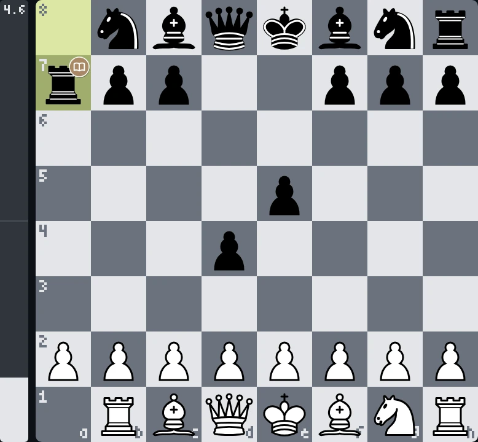
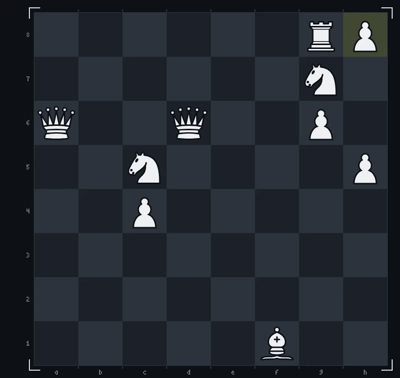
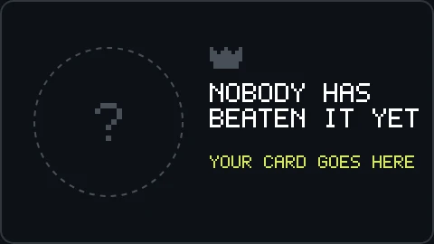

<!--
  Шапка рендерится canvas'ом офлайн (GitHub не исполняет JS в README):
    npm i
    npm run build        # render/game.mjs -> assets/chess-header.gif + assets/chess-header-static.png
  Спрайты фигур уже лежат в source/sprites/. Перерендерить их из 3D-модели
  (source/chess_set/, «Chess Set» с polyhaven.com/a/chess_set, CC0):
    npm run sprites      # и открыть http://localhost:5178
  Руки: source/gen/hand_{top,bottom,right}.png на зелёном фоне.
-->

<picture>
  <source media="(prefers-reduced-motion: reduce)" srcset="./assets/chess-header-static.png">
  
</picture>

<!-- chess:start -->
<table align="center">
<tr>
<td align="center"></td>
<td valign="top" width="300">
<h3>YOUR MOVE.</h3>
you play white vs stockfish · click a move, then <b>Create</b> 
<a href="https://github.com/2md55nmxkw-arch">@2md55nmxkw-arch</a> <code>Nxa7</code>  mistake · stockfish <code>Rxa7</code>  book 
 
♖︎&nbsp; <a href="https://github.com/2md55nmxkw-arch/2md55nmxkw-arch/issues/new?title=chess%7Cmove%7Cb1a1&body=Just+press+**Create**%2C+stockfish+answers+and+the+board+on+the+profile+updates+in+about+a+minute.%0A%0APlease+don%27t+change+the+title.">Ra1</a> 
♘︎&nbsp; <a href="https://github.com/2md55nmxkw-arch/2md55nmxkw-arch/issues/new?title=chess%7Cmove%7Cg1f3&body=Just+press+**Create**%2C+stockfish+answers+and+the+board+on+the+profile+updates+in+about+a+minute.%0A%0APlease+don%27t+change+the+title.">Nf3</a> <a href="https://github.com/2md55nmxkw-arch/2md55nmxkw-arch/issues/new?title=chess%7Cmove%7Cg1h3&body=Just+press+**Create**%2C+stockfish+answers+and+the+board+on+the+profile+updates+in+about+a+minute.%0A%0APlease+don%27t+change+the+title.">Nh3</a> 
♙︎&nbsp; <a href="https://github.com/2md55nmxkw-arch/2md55nmxkw-arch/issues/new?title=chess%7Cmove%7Ca2a3&body=Just+press+**Create**%2C+stockfish+answers+and+the+board+on+the+profile+updates+in+about+a+minute.%0A%0APlease+don%27t+change+the+title.">a3</a> <a href="https://github.com/2md55nmxkw-arch/2md55nmxkw-arch/issues/new?title=chess%7Cmove%7Ca2a4&body=Just+press+**Create**%2C+stockfish+answers+and+the+board+on+the+profile+updates+in+about+a+minute.%0A%0APlease+don%27t+change+the+title.">a4</a> <a href="https://github.com/2md55nmxkw-arch/2md55nmxkw-arch/issues/new?title=chess%7Cmove%7Cb2b3&body=Just+press+**Create**%2C+stockfish+answers+and+the+board+on+the+profile+updates+in+about+a+minute.%0A%0APlease+don%27t+change+the+title.">b3</a> <a href="https://github.com/2md55nmxkw-arch/2md55nmxkw-arch/issues/new?title=chess%7Cmove%7Cb2b4&body=Just+press+**Create**%2C+stockfish+answers+and+the+board+on+the+profile+updates+in+about+a+minute.%0A%0APlease+don%27t+change+the+title.">b4</a> <a href="https://github.com/2md55nmxkw-arch/2md55nmxkw-arch/issues/new?title=chess%7Cmove%7Cc2c3&body=Just+press+**Create**%2C+stockfish+answers+and+the+board+on+the+profile+updates+in+about+a+minute.%0A%0APlease+don%27t+change+the+title.">c3</a> <a href="https://github.com/2md55nmxkw-arch/2md55nmxkw-arch/issues/new?title=chess%7Cmove%7Cc2c4&body=Just+press+**Create**%2C+stockfish+answers+and+the+board+on+the+profile+updates+in+about+a+minute.%0A%0APlease+don%27t+change+the+title.">c4</a> <a href="https://github.com/2md55nmxkw-arch/2md55nmxkw-arch/issues/new?title=chess%7Cmove%7Cd2d3&body=Just+press+**Create**%2C+stockfish+answers+and+the+board+on+the+profile+updates+in+about+a+minute.%0A%0APlease+don%27t+change+the+title.">d3</a> <a href="https://github.com/2md55nmxkw-arch/2md55nmxkw-arch/issues/new?title=chess%7Cmove%7Ce2e3&body=Just+press+**Create**%2C+stockfish+answers+and+the+board+on+the+profile+updates+in+about+a+minute.%0A%0APlease+don%27t+change+the+title.">e3</a> <a href="https://github.com/2md55nmxkw-arch/2md55nmxkw-arch/issues/new?title=chess%7Cmove%7Ce2e4&body=Just+press+**Create**%2C+stockfish+answers+and+the+board+on+the+profile+updates+in+about+a+minute.%0A%0APlease+don%27t+change+the+title.">e4</a> <a href="https://github.com/2md55nmxkw-arch/2md55nmxkw-arch/issues/new?title=chess%7Cmove%7Cf2f3&body=Just+press+**Create**%2C+stockfish+answers+and+the+board+on+the+profile+updates+in+about+a+minute.%0A%0APlease+don%27t+change+the+title.">f3</a> <a href="https://github.com/2md55nmxkw-arch/2md55nmxkw-arch/issues/new?title=chess%7Cmove%7Cf2f4&body=Just+press+**Create**%2C+stockfish+answers+and+the+board+on+the+profile+updates+in+about+a+minute.%0A%0APlease+don%27t+change+the+title.">f4</a> <a href="https://github.com/2md55nmxkw-arch/2md55nmxkw-arch/issues/new?title=chess%7Cmove%7Cg2g3&body=Just+press+**Create**%2C+stockfish+answers+and+the+board+on+the+profile+updates+in+about+a+minute.%0A%0APlease+don%27t+change+the+title.">g3</a> <a href="https://github.com/2md55nmxkw-arch/2md55nmxkw-arch/issues/new?title=chess%7Cmove%7Cg2g4&body=Just+press+**Create**%2C+stockfish+answers+and+the+board+on+the+profile+updates+in+about+a+minute.%0A%0APlease+don%27t+change+the+title.">g4</a> <a href="https://github.com/2md55nmxkw-arch/2md55nmxkw-arch/issues/new?title=chess%7Cmove%7Ch2h3&body=Just+press+**Create**%2C+stockfish+answers+and+the+board+on+the+profile+updates+in+about+a+minute.%0A%0APlease+don%27t+change+the+title.">h3</a> <a href="https://github.com/2md55nmxkw-arch/2md55nmxkw-arch/issues/new?title=chess%7Cmove%7Ch2h4&body=Just+press+**Create**%2C+stockfish+answers+and+the+board+on+the+profile+updates+in+about+a+minute.%0A%0APlease+don%27t+change+the+title.">h4</a> 
 
</td>
</tr>
<tr>
<td align="center" valign="top">
 
last 64 days · every commit is a move
</td>
<td align="center" valign="top">

</td>
</tr>
</table>

history

| # | move | | by |
| --: | :-- | :-: | :-- |
| 4… | `Rxa7` |  | stockfish |
| 4. | `Nxa7` |  | [@2md55nmxkw-arch](https://github.com/2md55nmxkw-arch) |
| 3… | `d4` |  | stockfish |
| 3. | `Nb5` |  | [@2md55nmxkw-arch](https://github.com/2md55nmxkw-arch) |
| 2… | `e5` |  | stockfish |
| 2. | `Rb1` |  | [@2md55nmxkw-arch](https://github.com/2md55nmxkw-arch) |
| 1… | `d5` |  | stockfish |
| 1. | `Na3` |  | [@2md55nmxkw-arch](https://github.com/2md55nmxkw-arch) |

| player | moves |
| :-- | --: |
| [@2md55nmxkw-arch](https://github.com/2md55nmxkw-arch) | 4 |

<!-- chess:end -->

  header rendered with canvas&nbsp;·&nbsp;chess set 3D model by Riley Queen (<a href="https://polyhaven.com/a/chess_set">Poly Haven</a>, CC0)&nbsp;·&nbsp;board pieces by Cburnett (<a href="https://commons.wikimedia.org/wiki/Category:SVG_chess_pieces">Wikimedia Commons</a>, CC BY-SA 3.0)

