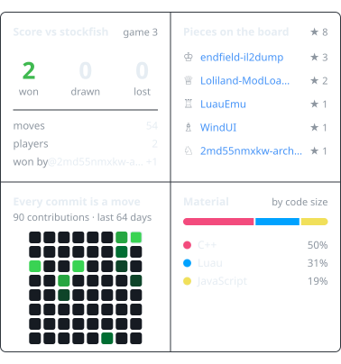
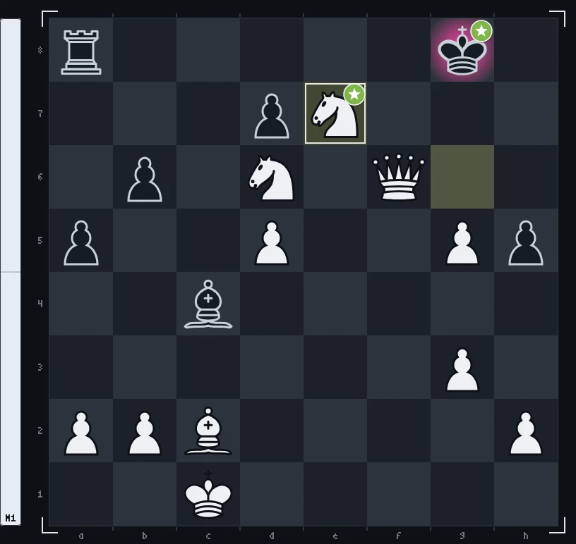

<!--
  Шапка рендерится canvas'ом офлайн (GitHub не исполняет JS в README):
    npm i
    npm run build        # render/game.mjs -> assets/chess-header.gif + assets/chess-header-static.png
  Спрайты фигур уже лежат в source/sprites/. Перерендерить их из 3D-модели
  (source/chess_set/, «Chess Set» с polyhaven.com/a/chess_set, CC0):
    npm run sprites      # и открыть http://localhost:5178
  Руки: source/gen/hand_{top,bottom,right}.png на зелёном фоне.
-->

<picture>
  <source media="(prefers-reduced-motion: reduce)" srcset="./assets/chess-header-static.png">
  
</picture>

<!-- chess:start -->
I take games and runtimes apart, then write the tools I wanted to have: an offline IL2CPP dumper, a mod loader, a Luau emulator. 
Mostly C++ and Luau, with TypeScript around the edges.

♙︎&nbsp; <a href="https://2md55nmxkw-arch.github.io">site</a>

<picture><source media="(prefers-color-scheme: dark)" srcset="chess/board-3-0-be1c69.webp"><source media="(prefers-color-scheme: light)" srcset="chess/board-3-0-be1c69-light.webp"></picture><picture><source media="(prefers-color-scheme: dark)" srcset="chess/panel-3141da.svg"><source media="(prefers-color-scheme: light)" srcset="chess/panel-3141da-light.svg"></picture>

**Your move.** You play white vs stockfish: click a move, then press Create.

game 2: <a href="https://github.com/2md55nmxkw-arch">@2md55nmxkw-arch</a> checkmated stockfish 👑

♘︎&nbsp; <a href="https://github.com/2md55nmxkw-arch/2md55nmxkw-arch/issues/new?title=chess%7Cmove%7Cb1a3&body=Just+press+**Create**%2C+stockfish+answers+and+the+board+on+the+profile+updates+in+about+a+minute.%0A%0APlease+don%27t+change+the+title.">Na3</a> <a href="https://github.com/2md55nmxkw-arch/2md55nmxkw-arch/issues/new?title=chess%7Cmove%7Cb1c3&body=Just+press+**Create**%2C+stockfish+answers+and+the+board+on+the+profile+updates+in+about+a+minute.%0A%0APlease+don%27t+change+the+title.">Nc3</a> <a href="https://github.com/2md55nmxkw-arch/2md55nmxkw-arch/issues/new?title=chess%7Cmove%7Cg1f3&body=Just+press+**Create**%2C+stockfish+answers+and+the+board+on+the+profile+updates+in+about+a+minute.%0A%0APlease+don%27t+change+the+title.">Nf3</a> <a href="https://github.com/2md55nmxkw-arch/2md55nmxkw-arch/issues/new?title=chess%7Cmove%7Cg1h3&body=Just+press+**Create**%2C+stockfish+answers+and+the+board+on+the+profile+updates+in+about+a+minute.%0A%0APlease+don%27t+change+the+title.">Nh3</a> 
♙︎&nbsp; <a href="https://github.com/2md55nmxkw-arch/2md55nmxkw-arch/issues/new?title=chess%7Cmove%7Ca2a3&body=Just+press+**Create**%2C+stockfish+answers+and+the+board+on+the+profile+updates+in+about+a+minute.%0A%0APlease+don%27t+change+the+title.">a3</a> <a href="https://github.com/2md55nmxkw-arch/2md55nmxkw-arch/issues/new?title=chess%7Cmove%7Ca2a4&body=Just+press+**Create**%2C+stockfish+answers+and+the+board+on+the+profile+updates+in+about+a+minute.%0A%0APlease+don%27t+change+the+title.">a4</a> <a href="https://github.com/2md55nmxkw-arch/2md55nmxkw-arch/issues/new?title=chess%7Cmove%7Cb2b3&body=Just+press+**Create**%2C+stockfish+answers+and+the+board+on+the+profile+updates+in+about+a+minute.%0A%0APlease+don%27t+change+the+title.">b3</a> <a href="https://github.com/2md55nmxkw-arch/2md55nmxkw-arch/issues/new?title=chess%7Cmove%7Cb2b4&body=Just+press+**Create**%2C+stockfish+answers+and+the+board+on+the+profile+updates+in+about+a+minute.%0A%0APlease+don%27t+change+the+title.">b4</a> <a href="https://github.com/2md55nmxkw-arch/2md55nmxkw-arch/issues/new?title=chess%7Cmove%7Cc2c3&body=Just+press+**Create**%2C+stockfish+answers+and+the+board+on+the+profile+updates+in+about+a+minute.%0A%0APlease+don%27t+change+the+title.">c3</a> <a href="https://github.com/2md55nmxkw-arch/2md55nmxkw-arch/issues/new?title=chess%7Cmove%7Cc2c4&body=Just+press+**Create**%2C+stockfish+answers+and+the+board+on+the+profile+updates+in+about+a+minute.%0A%0APlease+don%27t+change+the+title.">c4</a> <a href="https://github.com/2md55nmxkw-arch/2md55nmxkw-arch/issues/new?title=chess%7Cmove%7Cd2d3&body=Just+press+**Create**%2C+stockfish+answers+and+the+board+on+the+profile+updates+in+about+a+minute.%0A%0APlease+don%27t+change+the+title.">d3</a> <a href="https://github.com/2md55nmxkw-arch/2md55nmxkw-arch/issues/new?title=chess%7Cmove%7Cd2d4&body=Just+press+**Create**%2C+stockfish+answers+and+the+board+on+the+profile+updates+in+about+a+minute.%0A%0APlease+don%27t+change+the+title.">d4</a> <a href="https://github.com/2md55nmxkw-arch/2md55nmxkw-arch/issues/new?title=chess%7Cmove%7Ce2e3&body=Just+press+**Create**%2C+stockfish+answers+and+the+board+on+the+profile+updates+in+about+a+minute.%0A%0APlease+don%27t+change+the+title.">e3</a> <a href="https://github.com/2md55nmxkw-arch/2md55nmxkw-arch/issues/new?title=chess%7Cmove%7Ce2e4&body=Just+press+**Create**%2C+stockfish+answers+and+the+board+on+the+profile+updates+in+about+a+minute.%0A%0APlease+don%27t+change+the+title.">e4</a> <a href="https://github.com/2md55nmxkw-arch/2md55nmxkw-arch/issues/new?title=chess%7Cmove%7Cf2f3&body=Just+press+**Create**%2C+stockfish+answers+and+the+board+on+the+profile+updates+in+about+a+minute.%0A%0APlease+don%27t+change+the+title.">f3</a> <a href="https://github.com/2md55nmxkw-arch/2md55nmxkw-arch/issues/new?title=chess%7Cmove%7Cf2f4&body=Just+press+**Create**%2C+stockfish+answers+and+the+board+on+the+profile+updates+in+about+a+minute.%0A%0APlease+don%27t+change+the+title.">f4</a> <a href="https://github.com/2md55nmxkw-arch/2md55nmxkw-arch/issues/new?title=chess%7Cmove%7Cg2g3&body=Just+press+**Create**%2C+stockfish+answers+and+the+board+on+the+profile+updates+in+about+a+minute.%0A%0APlease+don%27t+change+the+title.">g3</a> <a href="https://github.com/2md55nmxkw-arch/2md55nmxkw-arch/issues/new?title=chess%7Cmove%7Cg2g4&body=Just+press+**Create**%2C+stockfish+answers+and+the+board+on+the+profile+updates+in+about+a+minute.%0A%0APlease+don%27t+change+the+title.">g4</a> <a href="https://github.com/2md55nmxkw-arch/2md55nmxkw-arch/issues/new?title=chess%7Cmove%7Ch2h3&body=Just+press+**Create**%2C+stockfish+answers+and+the+board+on+the+profile+updates+in+about+a+minute.%0A%0APlease+don%27t+change+the+title.">h3</a> <a href="https://github.com/2md55nmxkw-arch/2md55nmxkw-arch/issues/new?title=chess%7Cmove%7Ch2h4&body=Just+press+**Create**%2C+stockfish+answers+and+the+board+on+the+profile+updates+in+about+a+minute.%0A%0APlease+don%27t+change+the+title.">h4</a>

 

Hall of mate:  <a href="https://github.com/2md55nmxkw-arch">@2md55nmxkw-arch</a> (game 2) ·  <a href="https://github.com/2md55nmxkw-arch">@2md55nmxkw-arch</a> (game 1)

♔︎ <a href="https://github.com/2md55nmxkw-arch/endfield-il2dump">endfield-il2dump</a> · ♕︎ <a href="https://github.com/2md55nmxkw-arch/Loliland-ModLoader">Loliland-ModLoader</a> · ♖︎ <a href="https://github.com/2md55nmxkw-arch/LuauEmu">LuauEmu</a> · ♗︎ <a href="https://github.com/2md55nmxkw-arch/WindUI">WindUI</a> · ♘︎ <a href="https://github.com/2md55nmxkw-arch/2md55nmxkw-arch.github.io">2md55nmxkw-arch.github.io</a>

history

| player | moves |
| :-- | --: |
| [@2md55nmxkw-arch](https://github.com/2md55nmxkw-arch) | 52 |
| [@MedakhmetAsylmurat](https://github.com/MedakhmetAsylmurat) | 2 |

<picture><source media="(prefers-color-scheme: dark)" srcset="chess/final-2.webp"><source media="(prefers-color-scheme: light)" srcset="chess/final-2-light.webp"></picture>

| game | result | final move |
| :-: | :-- | :-- |
| 2 | 1-0 · checkmate | `Nxe7#` by [@2md55nmxkw-arch](https://github.com/2md55nmxkw-arch) |
| 1 | 1-0 · checkmate | `Qc7#` by [@2md55nmxkw-arch](https://github.com/2md55nmxkw-arch) |

<!-- chess:end -->

  header rendered with canvas&nbsp;·&nbsp;chess set 3D model by Riley Queen (<a href="https://polyhaven.com/a/chess_set">Poly Haven</a>, CC0)&nbsp;·&nbsp;board pieces by Cburnett (<a href="https://commons.wikimedia.org/wiki/Category:SVG_chess_pieces">Wikimedia Commons</a>, CC BY-SA 3.0)

