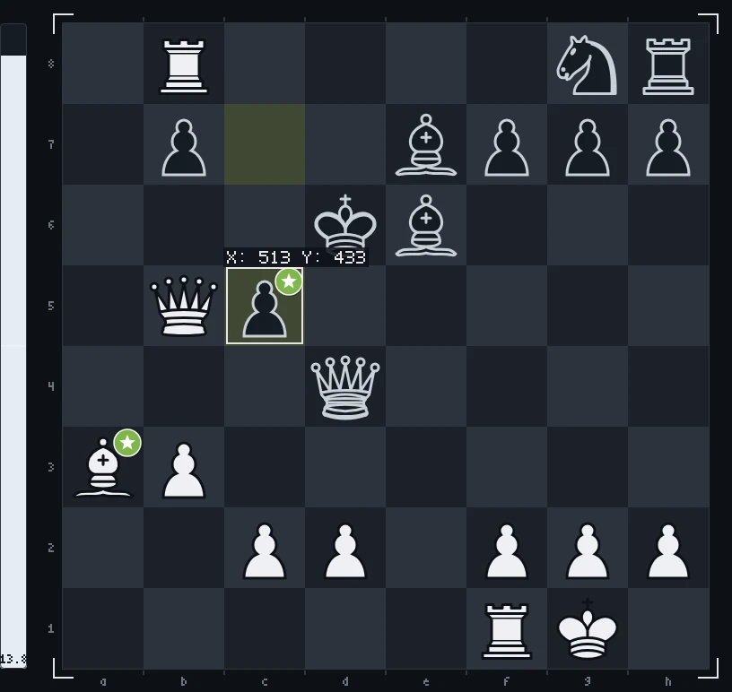

<!--
  Шапка рендерится canvas'ом офлайн (GitHub не исполняет JS в README):
    npm i
    npm run build        # render/game.mjs -> assets/chess-header.gif + assets/chess-header-static.png
  Спрайты фигур уже лежат в source/sprites/. Перерендерить их из 3D-модели
  (source/chess_set/, «Chess Set» с polyhaven.com/a/chess_set, CC0):
    npm run sprites      # и открыть http://localhost:5178
  Руки: source/gen/hand_{top,bottom,right}.png на зелёном фоне.
-->

<picture>
  <source media="(prefers-reduced-motion: reduce)" srcset="./assets/chess-header-static.png">
  
</picture>

<!-- chess:start -->

<a href="https://github.com/2md55nmxkw-arch">@2md55nmxkw-arch</a> <code>Ba3+</code>  best · stockfish <code>c5</code>  best

♔︎&nbsp; <a href="https://github.com/2md55nmxkw-arch/2md55nmxkw-arch/issues/new?title=chess%7Cmove%7Cg1h1&body=Just+press+**Create**%2C+stockfish+answers+and+the+board+on+the+profile+updates+in+about+a+minute.%0A%0APlease+don%27t+change+the+title.">Kh1</a> 
♕︎&nbsp; <a href="https://github.com/2md55nmxkw-arch/2md55nmxkw-arch/issues/new?title=chess%7Cmove%7Cb5a4&body=Just+press+**Create**%2C+stockfish+answers+and+the+board+on+the+profile+updates+in+about+a+minute.%0A%0APlease+don%27t+change+the+title.">Qa4</a> <a href="https://github.com/2md55nmxkw-arch/2md55nmxkw-arch/issues/new?title=chess%7Cmove%7Cb5a5&body=Just+press+**Create**%2C+stockfish+answers+and+the+board+on+the+profile+updates+in+about+a+minute.%0A%0APlease+don%27t+change+the+title.">Qa5</a> <a href="https://github.com/2md55nmxkw-arch/2md55nmxkw-arch/issues/new?title=chess%7Cmove%7Cb5a6&body=Just+press+**Create**%2C+stockfish+answers+and+the+board+on+the+profile+updates+in+about+a+minute.%0A%0APlease+don%27t+change+the+title.">Qa6+</a> <a href="https://github.com/2md55nmxkw-arch/2md55nmxkw-arch/issues/new?title=chess%7Cmove%7Cb5b4&body=Just+press+**Create**%2C+stockfish+answers+and+the+board+on+the+profile+updates+in+about+a+minute.%0A%0APlease+don%27t+change+the+title.">Qb4</a> <a href="https://github.com/2md55nmxkw-arch/2md55nmxkw-arch/issues/new?title=chess%7Cmove%7Cb5b6&body=Just+press+**Create**%2C+stockfish+answers+and+the+board+on+the+profile+updates+in+about+a+minute.%0A%0APlease+don%27t+change+the+title.">Qb6+</a> <a href="https://github.com/2md55nmxkw-arch/2md55nmxkw-arch/issues/new?title=chess%7Cmove%7Cb5b7&body=Just+press+**Create**%2C+stockfish+answers+and+the+board+on+the+profile+updates+in+about+a+minute.%0A%0APlease+don%27t+change+the+title.">Qxb7</a> <a href="https://github.com/2md55nmxkw-arch/2md55nmxkw-arch/issues/new?title=chess%7Cmove%7Cb5c4&body=Just+press+**Create**%2C+stockfish+answers+and+the+board+on+the+profile+updates+in+about+a+minute.%0A%0APlease+don%27t+change+the+title.">Qc4</a> <a href="https://github.com/2md55nmxkw-arch/2md55nmxkw-arch/issues/new?title=chess%7Cmove%7Cb5c5&body=Just+press+**Create**%2C+stockfish+answers+and+the+board+on+the+profile+updates+in+about+a+minute.%0A%0APlease+don%27t+change+the+title.">Qxc5+</a> <a href="https://github.com/2md55nmxkw-arch/2md55nmxkw-arch/issues/new?title=chess%7Cmove%7Cb5c6&body=Just+press+**Create**%2C+stockfish+answers+and+the+board+on+the+profile+updates+in+about+a+minute.%0A%0APlease+don%27t+change+the+title.">Qc6+</a> <a href="https://github.com/2md55nmxkw-arch/2md55nmxkw-arch/issues/new?title=chess%7Cmove%7Cb5d3&body=Just+press+**Create**%2C+stockfish+answers+and+the+board+on+the+profile+updates+in+about+a+minute.%0A%0APlease+don%27t+change+the+title.">Qd3</a> <a href="https://github.com/2md55nmxkw-arch/2md55nmxkw-arch/issues/new?title=chess%7Cmove%7Cb5d7&body=Just+press+**Create**%2C+stockfish+answers+and+the+board+on+the+profile+updates+in+about+a+minute.%0A%0APlease+don%27t+change+the+title.">Qd7+</a> <a href="https://github.com/2md55nmxkw-arch/2md55nmxkw-arch/issues/new?title=chess%7Cmove%7Cb5e2&body=Just+press+**Create**%2C+stockfish+answers+and+the+board+on+the+profile+updates+in+about+a+minute.%0A%0APlease+don%27t+change+the+title.">Qe2</a> <a href="https://github.com/2md55nmxkw-arch/2md55nmxkw-arch/issues/new?title=chess%7Cmove%7Cb5e8&body=Just+press+**Create**%2C+stockfish+answers+and+the+board+on+the+profile+updates+in+about+a+minute.%0A%0APlease+don%27t+change+the+title.">Qe8</a> 
♖︎&nbsp; <a href="https://github.com/2md55nmxkw-arch/2md55nmxkw-arch/issues/new?title=chess%7Cmove%7Cf1a1&body=Just+press+**Create**%2C+stockfish+answers+and+the+board+on+the+profile+updates+in+about+a+minute.%0A%0APlease+don%27t+change+the+title.">Ra1</a> <a href="https://github.com/2md55nmxkw-arch/2md55nmxkw-arch/issues/new?title=chess%7Cmove%7Cb8a8&body=Just+press+**Create**%2C+stockfish+answers+and+the+board+on+the+profile+updates+in+about+a+minute.%0A%0APlease+don%27t+change+the+title.">Ra8</a> <a href="https://github.com/2md55nmxkw-arch/2md55nmxkw-arch/issues/new?title=chess%7Cmove%7Cf1b1&body=Just+press+**Create**%2C+stockfish+answers+and+the+board+on+the+profile+updates+in+about+a+minute.%0A%0APlease+don%27t+change+the+title.">Rb1</a> <a href="https://github.com/2md55nmxkw-arch/2md55nmxkw-arch/issues/new?title=chess%7Cmove%7Cb8b7&body=Just+press+**Create**%2C+stockfish+answers+and+the+board+on+the+profile+updates+in+about+a+minute.%0A%0APlease+don%27t+change+the+title.">Rxb7</a> <a href="https://github.com/2md55nmxkw-arch/2md55nmxkw-arch/issues/new?title=chess%7Cmove%7Cf1c1&body=Just+press+**Create**%2C+stockfish+answers+and+the+board+on+the+profile+updates+in+about+a+minute.%0A%0APlease+don%27t+change+the+title.">Rc1</a> <a href="https://github.com/2md55nmxkw-arch/2md55nmxkw-arch/issues/new?title=chess%7Cmove%7Cb8c8&body=Just+press+**Create**%2C+stockfish+answers+and+the+board+on+the+profile+updates+in+about+a+minute.%0A%0APlease+don%27t+change+the+title.">Rc8</a> <a href="https://github.com/2md55nmxkw-arch/2md55nmxkw-arch/issues/new?title=chess%7Cmove%7Cf1d1&body=Just+press+**Create**%2C+stockfish+answers+and+the+board+on+the+profile+updates+in+about+a+minute.%0A%0APlease+don%27t+change+the+title.">Rd1</a> <a href="https://github.com/2md55nmxkw-arch/2md55nmxkw-arch/issues/new?title=chess%7Cmove%7Cb8d8&body=Just+press+**Create**%2C+stockfish+answers+and+the+board+on+the+profile+updates+in+about+a+minute.%0A%0APlease+don%27t+change+the+title.">Rd8+</a> <a href="https://github.com/2md55nmxkw-arch/2md55nmxkw-arch/issues/new?title=chess%7Cmove%7Cf1e1&body=Just+press+**Create**%2C+stockfish+answers+and+the+board+on+the+profile+updates+in+about+a+minute.%0A%0APlease+don%27t+change+the+title.">Re1</a> <a href="https://github.com/2md55nmxkw-arch/2md55nmxkw-arch/issues/new?title=chess%7Cmove%7Cb8e8&body=Just+press+**Create**%2C+stockfish+answers+and+the+board+on+the+profile+updates+in+about+a+minute.%0A%0APlease+don%27t+change+the+title.">Re8</a> <a href="https://github.com/2md55nmxkw-arch/2md55nmxkw-arch/issues/new?title=chess%7Cmove%7Cb8f8&body=Just+press+**Create**%2C+stockfish+answers+and+the+board+on+the+profile+updates+in+about+a+minute.%0A%0APlease+don%27t+change+the+title.">Rf8</a> <a href="https://github.com/2md55nmxkw-arch/2md55nmxkw-arch/issues/new?title=chess%7Cmove%7Cb8g8&body=Just+press+**Create**%2C+stockfish+answers+and+the+board+on+the+profile+updates+in+about+a+minute.%0A%0APlease+don%27t+change+the+title.">Rxg8</a> 
♗︎&nbsp; <a href="https://github.com/2md55nmxkw-arch/2md55nmxkw-arch/issues/new?title=chess%7Cmove%7Ca3b2&body=Just+press+**Create**%2C+stockfish+answers+and+the+board+on+the+profile+updates+in+about+a+minute.%0A%0APlease+don%27t+change+the+title.">Bb2</a> <a href="https://github.com/2md55nmxkw-arch/2md55nmxkw-arch/issues/new?title=chess%7Cmove%7Ca3b4&body=Just+press+**Create**%2C+stockfish+answers+and+the+board+on+the+profile+updates+in+about+a+minute.%0A%0APlease+don%27t+change+the+title.">Bb4</a> <a href="https://github.com/2md55nmxkw-arch/2md55nmxkw-arch/issues/new?title=chess%7Cmove%7Ca3c1&body=Just+press+**Create**%2C+stockfish+answers+and+the+board+on+the+profile+updates+in+about+a+minute.%0A%0APlease+don%27t+change+the+title.">Bc1</a> <a href="https://github.com/2md55nmxkw-arch/2md55nmxkw-arch/issues/new?title=chess%7Cmove%7Ca3c5&body=Just+press+**Create**%2C+stockfish+answers+and+the+board+on+the+profile+updates+in+about+a+minute.%0A%0APlease+don%27t+change+the+title.">Bxc5+</a> 
♙︎&nbsp; <a href="https://github.com/2md55nmxkw-arch/2md55nmxkw-arch/issues/new?title=chess%7Cmove%7Cb3b4&body=Just+press+**Create**%2C+stockfish+answers+and+the+board+on+the+profile+updates+in+about+a+minute.%0A%0APlease+don%27t+change+the+title.">b4</a> <a href="https://github.com/2md55nmxkw-arch/2md55nmxkw-arch/issues/new?title=chess%7Cmove%7Cc2c3&body=Just+press+**Create**%2C+stockfish+answers+and+the+board+on+the+profile+updates+in+about+a+minute.%0A%0APlease+don%27t+change+the+title.">c3</a> <a href="https://github.com/2md55nmxkw-arch/2md55nmxkw-arch/issues/new?title=chess%7Cmove%7Cc2c4&body=Just+press+**Create**%2C+stockfish+answers+and+the+board+on+the+profile+updates+in+about+a+minute.%0A%0APlease+don%27t+change+the+title.">c4</a> <a href="https://github.com/2md55nmxkw-arch/2md55nmxkw-arch/issues/new?title=chess%7Cmove%7Cd2d3&body=Just+press+**Create**%2C+stockfish+answers+and+the+board+on+the+profile+updates+in+about+a+minute.%0A%0APlease+don%27t+change+the+title.">d3</a> <a href="https://github.com/2md55nmxkw-arch/2md55nmxkw-arch/issues/new?title=chess%7Cmove%7Cg2g3&body=Just+press+**Create**%2C+stockfish+answers+and+the+board+on+the+profile+updates+in+about+a+minute.%0A%0APlease+don%27t+change+the+title.">g3</a> <a href="https://github.com/2md55nmxkw-arch/2md55nmxkw-arch/issues/new?title=chess%7Cmove%7Cg2g4&body=Just+press+**Create**%2C+stockfish+answers+and+the+board+on+the+profile+updates+in+about+a+minute.%0A%0APlease+don%27t+change+the+title.">g4</a> <a href="https://github.com/2md55nmxkw-arch/2md55nmxkw-arch/issues/new?title=chess%7Cmove%7Ch2h3&body=Just+press+**Create**%2C+stockfish+answers+and+the+board+on+the+profile+updates+in+about+a+minute.%0A%0APlease+don%27t+change+the+title.">h3</a> <a href="https://github.com/2md55nmxkw-arch/2md55nmxkw-arch/issues/new?title=chess%7Cmove%7Ch2h4&body=Just+press+**Create**%2C+stockfish+answers+and+the+board+on+the+profile+updates+in+about+a+minute.%0A%0APlease+don%27t+change+the+title.">h4</a>

 

52 contributions · today is the highlighted square

 

history

| # | move | | by |
| --: | :-- | :-: | :-- |
| 18… | `c5` |  | stockfish |
| 18. | `Ba3+` |  | [@2md55nmxkw-arch](https://github.com/2md55nmxkw-arch) |
| 17… | `Qd4` |  | stockfish |
| 17. | `b3` |  | [@2md55nmxkw-arch](https://github.com/2md55nmxkw-arch) |
| 16… | `Qg4` |  | stockfish |
| 16. | `O-O` |  | [@2md55nmxkw-arch](https://github.com/2md55nmxkw-arch) |
| 15… | `Kd6` |  | stockfish |
| 15. | `Qb5+` |  | [@2md55nmxkw-arch](https://github.com/2md55nmxkw-arch) |
| 14… | `Kd7` |  | stockfish |
| 14. | `Rxb8+` |  | [@2md55nmxkw-arch](https://github.com/2md55nmxkw-arch) |
| 13… | `Qxd4` |  | stockfish |
| 13. | `Nxd4` |  | [@2md55nmxkw-arch](https://github.com/2md55nmxkw-arch) |

| player | moves |
| :-- | --: |
| [@2md55nmxkw-arch](https://github.com/2md55nmxkw-arch) | 18 |

<!-- chess:end -->

  header rendered with canvas&nbsp;·&nbsp;chess set 3D model by Riley Queen (<a href="https://polyhaven.com/a/chess_set">Poly Haven</a>, CC0)&nbsp;·&nbsp;board pieces by Cburnett (<a href="https://commons.wikimedia.org/wiki/Category:SVG_chess_pieces">Wikimedia Commons</a>, CC BY-SA 3.0)

