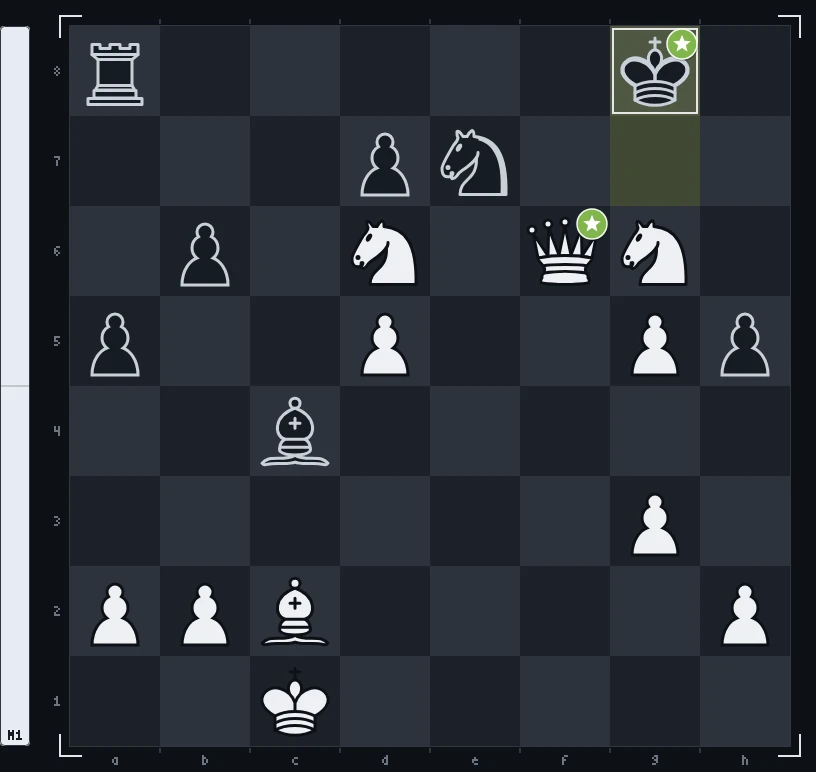

<!--
  Шапка рендерится canvas'ом офлайн (GitHub не исполняет JS в README):
    npm i
    npm run build        # render/game.mjs -> assets/chess-header.gif + assets/chess-header-static.png
  Спрайты фигур уже лежат в source/sprites/. Перерендерить их из 3D-модели
  (source/chess_set/, «Chess Set» с polyhaven.com/a/chess_set, CC0):
    npm run sprites      # и открыть http://localhost:5178
  Руки: source/gen/hand_{top,bottom,right}.png на зелёном фоне.
-->

<picture>
  <source media="(prefers-reduced-motion: reduce)" srcset="./assets/chess-header-static.png">
  
</picture>

<!-- chess:start -->
I take games and runtimes apart, then write the tools I wanted to have: an offline IL2CPP dumper, a mod loader, a Luau emulator. 
Mostly C++ and Luau, with TypeScript around the edges.

♙︎&nbsp; <a href="https://2md55nmxkw-arch.github.io">site</a>

<picture><source media="(prefers-color-scheme: dark)" srcset="chess/board-2-54-3d13fc.webp"><source media="(prefers-color-scheme: light)" srcset="chess/board-2-54-3d13fc-light.webp"></picture><picture><source media="(prefers-color-scheme: dark)" srcset="chess/panel-6d99b3.svg"><source media="(prefers-color-scheme: light)" srcset="chess/panel-6d99b3-light.svg"></picture>

**Your move.** You play white vs stockfish: click a move, then press Create.

<a href="https://github.com/2md55nmxkw-arch">@2md55nmxkw-arch</a> <code>Qxf6+</code>  best · stockfish <code>Kg8</code>  best

♔︎&nbsp; <a href="https://github.com/2md55nmxkw-arch/2md55nmxkw-arch/issues/new?title=chess%7Cmove%7Cc1b1&body=Just+press+**Create**%2C+stockfish+answers+and+the+board+on+the+profile+updates+in+about+a+minute.%0A%0APlease+don%27t+change+the+title.">Kb1</a> <a href="https://github.com/2md55nmxkw-arch/2md55nmxkw-arch/issues/new?title=chess%7Cmove%7Cc1d1&body=Just+press+**Create**%2C+stockfish+answers+and+the+board+on+the+profile+updates+in+about+a+minute.%0A%0APlease+don%27t+change+the+title.">Kd1</a> <a href="https://github.com/2md55nmxkw-arch/2md55nmxkw-arch/issues/new?title=chess%7Cmove%7Cc1d2&body=Just+press+**Create**%2C+stockfish+answers+and+the+board+on+the+profile+updates+in+about+a+minute.%0A%0APlease+don%27t+change+the+title.">Kd2</a> 
♕︎&nbsp; <a href="https://github.com/2md55nmxkw-arch/2md55nmxkw-arch/issues/new?title=chess%7Cmove%7Cf6c3&body=Just+press+**Create**%2C+stockfish+answers+and+the+board+on+the+profile+updates+in+about+a+minute.%0A%0APlease+don%27t+change+the+title.">Qc3</a> <a href="https://github.com/2md55nmxkw-arch/2md55nmxkw-arch/issues/new?title=chess%7Cmove%7Cf6d4&body=Just+press+**Create**%2C+stockfish+answers+and+the+board+on+the+profile+updates+in+about+a+minute.%0A%0APlease+don%27t+change+the+title.">Qd4</a> <a href="https://github.com/2md55nmxkw-arch/2md55nmxkw-arch/issues/new?title=chess%7Cmove%7Cf6e5&body=Just+press+**Create**%2C+stockfish+answers+and+the+board+on+the+profile+updates+in+about+a+minute.%0A%0APlease+don%27t+change+the+title.">Qe5</a> <a href="https://github.com/2md55nmxkw-arch/2md55nmxkw-arch/issues/new?title=chess%7Cmove%7Cf6e6&body=Just+press+**Create**%2C+stockfish+answers+and+the+board+on+the+profile+updates+in+about+a+minute.%0A%0APlease+don%27t+change+the+title.">Qe6+</a> <a href="https://github.com/2md55nmxkw-arch/2md55nmxkw-arch/issues/new?title=chess%7Cmove%7Cf6e7&body=Just+press+**Create**%2C+stockfish+answers+and+the+board+on+the+profile+updates+in+about+a+minute.%0A%0APlease+don%27t+change+the+title.">Qxe7</a> <a href="https://github.com/2md55nmxkw-arch/2md55nmxkw-arch/issues/new?title=chess%7Cmove%7Cf6f1&body=Just+press+**Create**%2C+stockfish+answers+and+the+board+on+the+profile+updates+in+about+a+minute.%0A%0APlease+don%27t+change+the+title.">Qf1</a> <a href="https://github.com/2md55nmxkw-arch/2md55nmxkw-arch/issues/new?title=chess%7Cmove%7Cf6f2&body=Just+press+**Create**%2C+stockfish+answers+and+the+board+on+the+profile+updates+in+about+a+minute.%0A%0APlease+don%27t+change+the+title.">Qf2</a> <a href="https://github.com/2md55nmxkw-arch/2md55nmxkw-arch/issues/new?title=chess%7Cmove%7Cf6f3&body=Just+press+**Create**%2C+stockfish+answers+and+the+board+on+the+profile+updates+in+about+a+minute.%0A%0APlease+don%27t+change+the+title.">Qf3</a> <a href="https://github.com/2md55nmxkw-arch/2md55nmxkw-arch/issues/new?title=chess%7Cmove%7Cf6f4&body=Just+press+**Create**%2C+stockfish+answers+and+the+board+on+the+profile+updates+in+about+a+minute.%0A%0APlease+don%27t+change+the+title.">Qf4</a> <a href="https://github.com/2md55nmxkw-arch/2md55nmxkw-arch/issues/new?title=chess%7Cmove%7Cf6f5&body=Just+press+**Create**%2C+stockfish+answers+and+the+board+on+the+profile+updates+in+about+a+minute.%0A%0APlease+don%27t+change+the+title.">Qf5</a> <a href="https://github.com/2md55nmxkw-arch/2md55nmxkw-arch/issues/new?title=chess%7Cmove%7Cf6f7&body=Just+press+**Create**%2C+stockfish+answers+and+the+board+on+the+profile+updates+in+about+a+minute.%0A%0APlease+don%27t+change+the+title.">Qf7#</a> <a href="https://github.com/2md55nmxkw-arch/2md55nmxkw-arch/issues/new?title=chess%7Cmove%7Cf6f8&body=Just+press+**Create**%2C+stockfish+answers+and+the+board+on+the+profile+updates+in+about+a+minute.%0A%0APlease+don%27t+change+the+title.">Qf8+</a> <a href="https://github.com/2md55nmxkw-arch/2md55nmxkw-arch/issues/new?title=chess%7Cmove%7Cf6g7&body=Just+press+**Create**%2C+stockfish+answers+and+the+board+on+the+profile+updates+in+about+a+minute.%0A%0APlease+don%27t+change+the+title.">Qg7+</a> <a href="https://github.com/2md55nmxkw-arch/2md55nmxkw-arch/issues/new?title=chess%7Cmove%7Cf6h8&body=Just+press+**Create**%2C+stockfish+answers+and+the+board+on+the+profile+updates+in+about+a+minute.%0A%0APlease+don%27t+change+the+title.">Qh8#</a> 
♗︎&nbsp; <a href="https://github.com/2md55nmxkw-arch/2md55nmxkw-arch/issues/new?title=chess%7Cmove%7Cc2a4&body=Just+press+**Create**%2C+stockfish+answers+and+the+board+on+the+profile+updates+in+about+a+minute.%0A%0APlease+don%27t+change+the+title.">Ba4</a> <a href="https://github.com/2md55nmxkw-arch/2md55nmxkw-arch/issues/new?title=chess%7Cmove%7Cc2b1&body=Just+press+**Create**%2C+stockfish+answers+and+the+board+on+the+profile+updates+in+about+a+minute.%0A%0APlease+don%27t+change+the+title.">Bb1</a> <a href="https://github.com/2md55nmxkw-arch/2md55nmxkw-arch/issues/new?title=chess%7Cmove%7Cc2b3&body=Just+press+**Create**%2C+stockfish+answers+and+the+board+on+the+profile+updates+in+about+a+minute.%0A%0APlease+don%27t+change+the+title.">Bb3</a> <a href="https://github.com/2md55nmxkw-arch/2md55nmxkw-arch/issues/new?title=chess%7Cmove%7Cc2d1&body=Just+press+**Create**%2C+stockfish+answers+and+the+board+on+the+profile+updates+in+about+a+minute.%0A%0APlease+don%27t+change+the+title.">Bd1</a> <a href="https://github.com/2md55nmxkw-arch/2md55nmxkw-arch/issues/new?title=chess%7Cmove%7Cc2d3&body=Just+press+**Create**%2C+stockfish+answers+and+the+board+on+the+profile+updates+in+about+a+minute.%0A%0APlease+don%27t+change+the+title.">Bd3</a> <a href="https://github.com/2md55nmxkw-arch/2md55nmxkw-arch/issues/new?title=chess%7Cmove%7Cc2e4&body=Just+press+**Create**%2C+stockfish+answers+and+the+board+on+the+profile+updates+in+about+a+minute.%0A%0APlease+don%27t+change+the+title.">Be4</a> <a href="https://github.com/2md55nmxkw-arch/2md55nmxkw-arch/issues/new?title=chess%7Cmove%7Cc2f5&body=Just+press+**Create**%2C+stockfish+answers+and+the+board+on+the+profile+updates+in+about+a+minute.%0A%0APlease+don%27t+change+the+title.">Bf5</a> 
♘︎&nbsp; <a href="https://github.com/2md55nmxkw-arch/2md55nmxkw-arch/issues/new?title=chess%7Cmove%7Cd6b5&body=Just+press+**Create**%2C+stockfish+answers+and+the+board+on+the+profile+updates+in+about+a+minute.%0A%0APlease+don%27t+change+the+title.">Nb5</a> <a href="https://github.com/2md55nmxkw-arch/2md55nmxkw-arch/issues/new?title=chess%7Cmove%7Cd6b7&body=Just+press+**Create**%2C+stockfish+answers+and+the+board+on+the+profile+updates+in+about+a+minute.%0A%0APlease+don%27t+change+the+title.">Nb7</a> <a href="https://github.com/2md55nmxkw-arch/2md55nmxkw-arch/issues/new?title=chess%7Cmove%7Cd6c4&body=Just+press+**Create**%2C+stockfish+answers+and+the+board+on+the+profile+updates+in+about+a+minute.%0A%0APlease+don%27t+change+the+title.">Nxc4</a> <a href="https://github.com/2md55nmxkw-arch/2md55nmxkw-arch/issues/new?title=chess%7Cmove%7Cd6c8&body=Just+press+**Create**%2C+stockfish+answers+and+the+board+on+the+profile+updates+in+about+a+minute.%0A%0APlease+don%27t+change+the+title.">Nc8</a> <a href="https://github.com/2md55nmxkw-arch/2md55nmxkw-arch/issues/new?title=chess%7Cmove%7Cd6e4&body=Just+press+**Create**%2C+stockfish+answers+and+the+board+on+the+profile+updates+in+about+a+minute.%0A%0APlease+don%27t+change+the+title.">Ne4</a> <a href="https://github.com/2md55nmxkw-arch/2md55nmxkw-arch/issues/new?title=chess%7Cmove%7Cg6e5&body=Just+press+**Create**%2C+stockfish+answers+and+the+board+on+the+profile+updates+in+about+a+minute.%0A%0APlease+don%27t+change+the+title.">Ne5</a> <a href="https://github.com/2md55nmxkw-arch/2md55nmxkw-arch/issues/new?title=chess%7Cmove%7Cg6e7&body=Just+press+**Create**%2C+stockfish+answers+and+the+board+on+the+profile+updates+in+about+a+minute.%0A%0APlease+don%27t+change+the+title.">Nxe7#</a> <a href="https://github.com/2md55nmxkw-arch/2md55nmxkw-arch/issues/new?title=chess%7Cmove%7Cd6e8&body=Just+press+**Create**%2C+stockfish+answers+and+the+board+on+the+profile+updates+in+about+a+minute.%0A%0APlease+don%27t+change+the+title.">Ne8</a> <a href="https://github.com/2md55nmxkw-arch/2md55nmxkw-arch/issues/new?title=chess%7Cmove%7Cg6f4&body=Just+press+**Create**%2C+stockfish+answers+and+the+board+on+the+profile+updates+in+about+a+minute.%0A%0APlease+don%27t+change+the+title.">Nf4</a> <a href="https://github.com/2md55nmxkw-arch/2md55nmxkw-arch/issues/new?title=chess%7Cmove%7Cd6f5&body=Just+press+**Create**%2C+stockfish+answers+and+the+board+on+the+profile+updates+in+about+a+minute.%0A%0APlease+don%27t+change+the+title.">Nf5</a> <a href="https://github.com/2md55nmxkw-arch/2md55nmxkw-arch/issues/new?title=chess%7Cmove%7Cd6f7&body=Just+press+**Create**%2C+stockfish+answers+and+the+board+on+the+profile+updates+in+about+a+minute.%0A%0APlease+don%27t+change+the+title.">Nf7</a> <a href="https://github.com/2md55nmxkw-arch/2md55nmxkw-arch/issues/new?title=chess%7Cmove%7Cg6f8&body=Just+press+**Create**%2C+stockfish+answers+and+the+board+on+the+profile+updates+in+about+a+minute.%0A%0APlease+don%27t+change+the+title.">Nf8</a> <a href="https://github.com/2md55nmxkw-arch/2md55nmxkw-arch/issues/new?title=chess%7Cmove%7Cg6h4&body=Just+press+**Create**%2C+stockfish+answers+and+the+board+on+the+profile+updates+in+about+a+minute.%0A%0APlease+don%27t+change+the+title.">Nh4</a> <a href="https://github.com/2md55nmxkw-arch/2md55nmxkw-arch/issues/new?title=chess%7Cmove%7Cg6h8&body=Just+press+**Create**%2C+stockfish+answers+and+the+board+on+the+profile+updates+in+about+a+minute.%0A%0APlease+don%27t+change+the+title.">Nh8</a> 
♙︎&nbsp; <a href="https://github.com/2md55nmxkw-arch/2md55nmxkw-arch/issues/new?title=chess%7Cmove%7Ca2a3&body=Just+press+**Create**%2C+stockfish+answers+and+the+board+on+the+profile+updates+in+about+a+minute.%0A%0APlease+don%27t+change+the+title.">a3</a> <a href="https://github.com/2md55nmxkw-arch/2md55nmxkw-arch/issues/new?title=chess%7Cmove%7Ca2a4&body=Just+press+**Create**%2C+stockfish+answers+and+the+board+on+the+profile+updates+in+about+a+minute.%0A%0APlease+don%27t+change+the+title.">a4</a> <a href="https://github.com/2md55nmxkw-arch/2md55nmxkw-arch/issues/new?title=chess%7Cmove%7Cb2b3&body=Just+press+**Create**%2C+stockfish+answers+and+the+board+on+the+profile+updates+in+about+a+minute.%0A%0APlease+don%27t+change+the+title.">b3</a> <a href="https://github.com/2md55nmxkw-arch/2md55nmxkw-arch/issues/new?title=chess%7Cmove%7Cb2b4&body=Just+press+**Create**%2C+stockfish+answers+and+the+board+on+the+profile+updates+in+about+a+minute.%0A%0APlease+don%27t+change+the+title.">b4</a> <a href="https://github.com/2md55nmxkw-arch/2md55nmxkw-arch/issues/new?title=chess%7Cmove%7Cg3g4&body=Just+press+**Create**%2C+stockfish+answers+and+the+board+on+the+profile+updates+in+about+a+minute.%0A%0APlease+don%27t+change+the+title.">g4</a> <a href="https://github.com/2md55nmxkw-arch/2md55nmxkw-arch/issues/new?title=chess%7Cmove%7Ch2h3&body=Just+press+**Create**%2C+stockfish+answers+and+the+board+on+the+profile+updates+in+about+a+minute.%0A%0APlease+don%27t+change+the+title.">h3</a> <a href="https://github.com/2md55nmxkw-arch/2md55nmxkw-arch/issues/new?title=chess%7Cmove%7Ch2h4&body=Just+press+**Create**%2C+stockfish+answers+and+the+board+on+the+profile+updates+in+about+a+minute.%0A%0APlease+don%27t+change+the+title.">h4</a>

 

Hall of mate:  <a href="https://github.com/2md55nmxkw-arch">@2md55nmxkw-arch</a> (game 1)

♔︎ <a href="https://github.com/2md55nmxkw-arch/endfield-il2dump">endfield-il2dump</a> · ♕︎ <a href="https://github.com/2md55nmxkw-arch/Loliland-ModLoader">Loliland-ModLoader</a> · ♖︎ <a href="https://github.com/2md55nmxkw-arch/LuauEmu">LuauEmu</a> · ♗︎ <a href="https://github.com/2md55nmxkw-arch/WindUI">WindUI</a> · ♘︎ <a href="https://github.com/2md55nmxkw-arch/2md55nmxkw-arch.github.io">2md55nmxkw-arch.github.io</a>

history

| # | move | | by |
| --: | :-- | :-: | :-- |
| 27… | `Kg8` |  | stockfish |
| 27. | `Qxf6+` |  | [@2md55nmxkw-arch](https://github.com/2md55nmxkw-arch) |
| 26… | `Nxe7` |  | stockfish |
| 26. | `Re7+` |  | [@2md55nmxkw-arch](https://github.com/2md55nmxkw-arch) |
| 25… | `Kg7` |  | stockfish |
| 25. | `Ng6+` |  | [@2md55nmxkw-arch](https://github.com/2md55nmxkw-arch) |
| 24… | `Bxc4` |  | stockfish |
| 24. | `Nxh8` |  | [@2md55nmxkw-arch](https://github.com/2md55nmxkw-arch) |
| 23… | `Kf8` |  | stockfish |
| 23. | `Nef7+` |  | [@2md55nmxkw-arch](https://github.com/2md55nmxkw-arch) |
| 22… | `Ke7` |  | stockfish |
| 22. | `fxg5` |  | [@2md55nmxkw-arch](https://github.com/2md55nmxkw-arch) |

| player | moves |
| :-- | --: |
| [@2md55nmxkw-arch](https://github.com/2md55nmxkw-arch) | 51 |
| [@MedakhmetAsylmurat](https://github.com/MedakhmetAsylmurat) | 2 |

<picture><source media="(prefers-color-scheme: dark)" srcset="chess/final-1.webp"><source media="(prefers-color-scheme: light)" srcset="chess/final-1-light.webp"></picture>

| game | result | final move |
| :-: | :-- | :-- |
| 1 | 1-0 · checkmate | `Qc7#` by [@2md55nmxkw-arch](https://github.com/2md55nmxkw-arch) |

<!-- chess:end -->

  header rendered with canvas&nbsp;·&nbsp;chess set 3D model by Riley Queen (<a href="https://polyhaven.com/a/chess_set">Poly Haven</a>, CC0)&nbsp;·&nbsp;board pieces by Cburnett (<a href="https://commons.wikimedia.org/wiki/Category:SVG_chess_pieces">Wikimedia Commons</a>, CC BY-SA 3.0)

