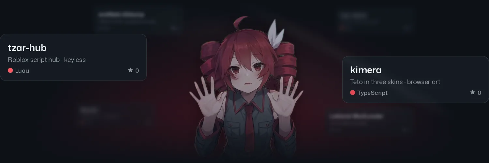
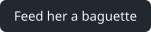
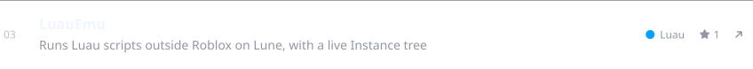
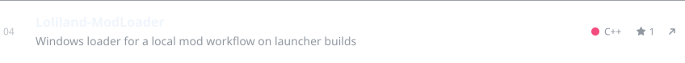
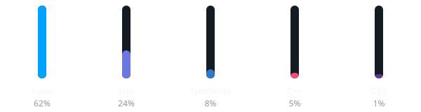

<!--
  This README is generated. Edit teto/README.template.md and teto/config.json, then run:
    pip install fonttools brotli && python teto/build.py
  Actions rebuild it every day (teto-daily) and when someone talks to Teto (teto-issue).
-->

<picture>
  <source media="(prefers-reduced-motion: reduce)" srcset="./assets/teto/banner-static.png">
  
</picture>

  

  
  
  
   
  

 

 

 
 
 

 

 

  

 

  

