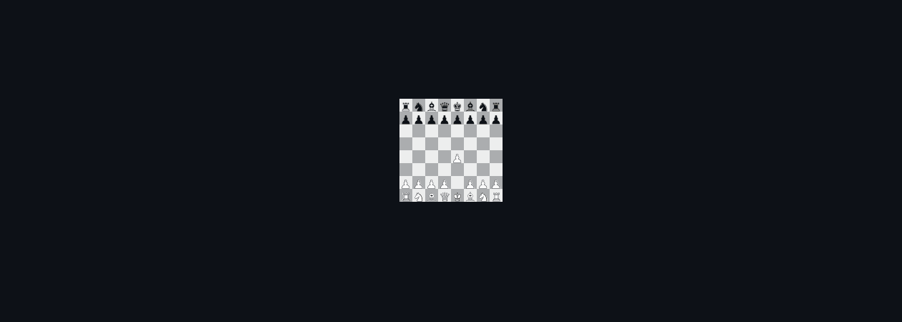

<!--
  Шапка рендерится canvas'ом офлайн (GitHub не исполняет JS в README):
    npm i
    npm run build        # render/game.mjs -> assets/header.gif + assets/header-static.png
  Спрайты фигур уже лежат в source/sprites/. Перерендерить их:
    скачать glTF 2k «Chess Set» с polyhaven.com/a/chess_set в source/chess_set/,
    npm run sprites      # и открыть http://localhost:5178
  Руки: source/gen/hand_{top,bottom,right}.png на зелёном фоне.
-->

<picture>
  <source media="(prefers-reduced-motion: reduce)" srcset="./assets/header-static.png">
  
</picture>

  <code>c++</code>&nbsp;&nbsp;<code>luau</code>&nbsp;&nbsp;<code>lua</code>&nbsp;&nbsp;<code>typescript</code>&nbsp;&nbsp;<code>python</code>

  header rendered with canvas&nbsp;·&nbsp;chess set 3D model by Riley Queen (<a href="https://polyhaven.com/a/chess_set">Poly Haven</a>, CC0)

