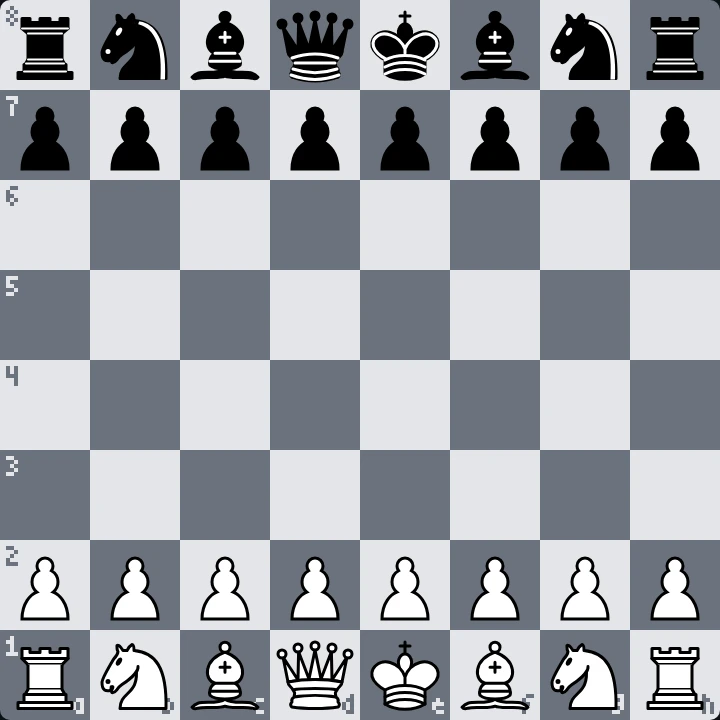

<!--
  Шапка рендерится canvas'ом офлайн (GitHub не исполняет JS в README):
    npm i
    npm run build        # render/game.mjs -> assets/chess-header.gif + assets/chess-header-static.png
  Спрайты фигур уже лежат в source/sprites/. Перерендерить их из 3D-модели
  (source/chess_set/, «Chess Set» с polyhaven.com/a/chess_set, CC0):
    npm run sprites      # и открыть http://localhost:5178
  Руки: source/gen/hand_{top,bottom,right}.png на зелёном фоне.
-->

<picture>
  <source media="(prefers-reduced-motion: reduce)" srcset="./assets/chess-header-static.png">
  
</picture>

<!-- chess:start -->
<h3 align="center">YOUR MOVE.</h3>

an open game anyone can play: pick a move below, press <b>Create</b> on the issue that opens, and the board updates in about a minute

<b>white</b> to move · move 1

| white | moves |
| :-: | :-- |
| ♘︎ b1 | [a3](https://github.com/2md55nmxkw-arch/2md55nmxkw-arch/issues/new?title=chess%7Cmove%7Cb1a3&body=Just+press+**Create**%2C+the+board+on+the+profile+updates+in+about+a+minute.%0A%0APlease+don%27t+change+the+title.) · [c3](https://github.com/2md55nmxkw-arch/2md55nmxkw-arch/issues/new?title=chess%7Cmove%7Cb1c3&body=Just+press+**Create**%2C+the+board+on+the+profile+updates+in+about+a+minute.%0A%0APlease+don%27t+change+the+title.) |
| ♘︎ g1 | [f3](https://github.com/2md55nmxkw-arch/2md55nmxkw-arch/issues/new?title=chess%7Cmove%7Cg1f3&body=Just+press+**Create**%2C+the+board+on+the+profile+updates+in+about+a+minute.%0A%0APlease+don%27t+change+the+title.) · [h3](https://github.com/2md55nmxkw-arch/2md55nmxkw-arch/issues/new?title=chess%7Cmove%7Cg1h3&body=Just+press+**Create**%2C+the+board+on+the+profile+updates+in+about+a+minute.%0A%0APlease+don%27t+change+the+title.) |
| ♙︎ a2 | [a3](https://github.com/2md55nmxkw-arch/2md55nmxkw-arch/issues/new?title=chess%7Cmove%7Ca2a3&body=Just+press+**Create**%2C+the+board+on+the+profile+updates+in+about+a+minute.%0A%0APlease+don%27t+change+the+title.) · [a4](https://github.com/2md55nmxkw-arch/2md55nmxkw-arch/issues/new?title=chess%7Cmove%7Ca2a4&body=Just+press+**Create**%2C+the+board+on+the+profile+updates+in+about+a+minute.%0A%0APlease+don%27t+change+the+title.) |
| ♙︎ b2 | [b3](https://github.com/2md55nmxkw-arch/2md55nmxkw-arch/issues/new?title=chess%7Cmove%7Cb2b3&body=Just+press+**Create**%2C+the+board+on+the+profile+updates+in+about+a+minute.%0A%0APlease+don%27t+change+the+title.) · [b4](https://github.com/2md55nmxkw-arch/2md55nmxkw-arch/issues/new?title=chess%7Cmove%7Cb2b4&body=Just+press+**Create**%2C+the+board+on+the+profile+updates+in+about+a+minute.%0A%0APlease+don%27t+change+the+title.) |
| ♙︎ c2 | [c3](https://github.com/2md55nmxkw-arch/2md55nmxkw-arch/issues/new?title=chess%7Cmove%7Cc2c3&body=Just+press+**Create**%2C+the+board+on+the+profile+updates+in+about+a+minute.%0A%0APlease+don%27t+change+the+title.) · [c4](https://github.com/2md55nmxkw-arch/2md55nmxkw-arch/issues/new?title=chess%7Cmove%7Cc2c4&body=Just+press+**Create**%2C+the+board+on+the+profile+updates+in+about+a+minute.%0A%0APlease+don%27t+change+the+title.) |
| ♙︎ d2 | [d3](https://github.com/2md55nmxkw-arch/2md55nmxkw-arch/issues/new?title=chess%7Cmove%7Cd2d3&body=Just+press+**Create**%2C+the+board+on+the+profile+updates+in+about+a+minute.%0A%0APlease+don%27t+change+the+title.) · [d4](https://github.com/2md55nmxkw-arch/2md55nmxkw-arch/issues/new?title=chess%7Cmove%7Cd2d4&body=Just+press+**Create**%2C+the+board+on+the+profile+updates+in+about+a+minute.%0A%0APlease+don%27t+change+the+title.) |
| ♙︎ e2 | [e3](https://github.com/2md55nmxkw-arch/2md55nmxkw-arch/issues/new?title=chess%7Cmove%7Ce2e3&body=Just+press+**Create**%2C+the+board+on+the+profile+updates+in+about+a+minute.%0A%0APlease+don%27t+change+the+title.) · [e4](https://github.com/2md55nmxkw-arch/2md55nmxkw-arch/issues/new?title=chess%7Cmove%7Ce2e4&body=Just+press+**Create**%2C+the+board+on+the+profile+updates+in+about+a+minute.%0A%0APlease+don%27t+change+the+title.) |
| ♙︎ f2 | [f3](https://github.com/2md55nmxkw-arch/2md55nmxkw-arch/issues/new?title=chess%7Cmove%7Cf2f3&body=Just+press+**Create**%2C+the+board+on+the+profile+updates+in+about+a+minute.%0A%0APlease+don%27t+change+the+title.) · [f4](https://github.com/2md55nmxkw-arch/2md55nmxkw-arch/issues/new?title=chess%7Cmove%7Cf2f4&body=Just+press+**Create**%2C+the+board+on+the+profile+updates+in+about+a+minute.%0A%0APlease+don%27t+change+the+title.) |
| ♙︎ g2 | [g3](https://github.com/2md55nmxkw-arch/2md55nmxkw-arch/issues/new?title=chess%7Cmove%7Cg2g3&body=Just+press+**Create**%2C+the+board+on+the+profile+updates+in+about+a+minute.%0A%0APlease+don%27t+change+the+title.) · [g4](https://github.com/2md55nmxkw-arch/2md55nmxkw-arch/issues/new?title=chess%7Cmove%7Cg2g4&body=Just+press+**Create**%2C+the+board+on+the+profile+updates+in+about+a+minute.%0A%0APlease+don%27t+change+the+title.) |
| ♙︎ h2 | [h3](https://github.com/2md55nmxkw-arch/2md55nmxkw-arch/issues/new?title=chess%7Cmove%7Ch2h3&body=Just+press+**Create**%2C+the+board+on+the+profile+updates+in+about+a+minute.%0A%0APlease+don%27t+change+the+title.) · [h4](https://github.com/2md55nmxkw-arch/2md55nmxkw-arch/issues/new?title=chess%7Cmove%7Ch2h4&body=Just+press+**Create**%2C+the+board+on+the+profile+updates+in+about+a+minute.%0A%0APlease+don%27t+change+the+title.) |

moves · players · past games

no moves yet, be the first.

<!-- chess:end -->

  header rendered with canvas&nbsp;·&nbsp;chess set 3D model by Riley Queen (<a href="https://polyhaven.com/a/chess_set">Poly Haven</a>, CC0)&nbsp;·&nbsp;board pieces by Cburnett (<a href="https://commons.wikimedia.org/wiki/Category:SVG_chess_pieces">Wikimedia Commons</a>, CC BY-SA 3.0)

