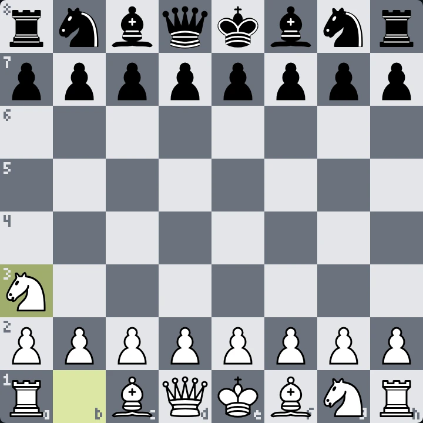

<!--
  Шапка рендерится canvas'ом офлайн (GitHub не исполняет JS в README):
    npm i
    npm run build        # render/game.mjs -> assets/chess-header.gif + assets/chess-header-static.png
  Спрайты фигур уже лежат в source/sprites/. Перерендерить их из 3D-модели
  (source/chess_set/, «Chess Set» с polyhaven.com/a/chess_set, CC0):
    npm run sprites      # и открыть http://localhost:5178
  Руки: source/gen/hand_{top,bottom,right}.png на зелёном фоне.
-->

<picture>
  <source media="(prefers-reduced-motion: reduce)" srcset="./assets/chess-header-static.png">
  
</picture>

<!-- chess:start -->
<h3 align="center">YOUR MOVE.</h3>

an open game anyone can play: pick a move below, press <b>Create</b> on the issue that opens, and the board updates in about a minute

<b>black</b> to move · move 1 · last <code>Na3</code> by <a href="https://github.com/2md55nmxkw-arch">@2md55nmxkw-arch</a>

| black | moves |
| :-: | :-- |
| ♞︎ b8 | [c6](https://github.com/2md55nmxkw-arch/2md55nmxkw-arch/issues/new?title=chess%7Cmove%7Cb8c6&body=Just+press+**Create**%2C+the+board+on+the+profile+updates+in+about+a+minute.%0A%0APlease+don%27t+change+the+title.) · [a6](https://github.com/2md55nmxkw-arch/2md55nmxkw-arch/issues/new?title=chess%7Cmove%7Cb8a6&body=Just+press+**Create**%2C+the+board+on+the+profile+updates+in+about+a+minute.%0A%0APlease+don%27t+change+the+title.) |
| ♞︎ g8 | [h6](https://github.com/2md55nmxkw-arch/2md55nmxkw-arch/issues/new?title=chess%7Cmove%7Cg8h6&body=Just+press+**Create**%2C+the+board+on+the+profile+updates+in+about+a+minute.%0A%0APlease+don%27t+change+the+title.) · [f6](https://github.com/2md55nmxkw-arch/2md55nmxkw-arch/issues/new?title=chess%7Cmove%7Cg8f6&body=Just+press+**Create**%2C+the+board+on+the+profile+updates+in+about+a+minute.%0A%0APlease+don%27t+change+the+title.) |
| ♟︎ a7 | [a6](https://github.com/2md55nmxkw-arch/2md55nmxkw-arch/issues/new?title=chess%7Cmove%7Ca7a6&body=Just+press+**Create**%2C+the+board+on+the+profile+updates+in+about+a+minute.%0A%0APlease+don%27t+change+the+title.) · [a5](https://github.com/2md55nmxkw-arch/2md55nmxkw-arch/issues/new?title=chess%7Cmove%7Ca7a5&body=Just+press+**Create**%2C+the+board+on+the+profile+updates+in+about+a+minute.%0A%0APlease+don%27t+change+the+title.) |
| ♟︎ b7 | [b6](https://github.com/2md55nmxkw-arch/2md55nmxkw-arch/issues/new?title=chess%7Cmove%7Cb7b6&body=Just+press+**Create**%2C+the+board+on+the+profile+updates+in+about+a+minute.%0A%0APlease+don%27t+change+the+title.) · [b5](https://github.com/2md55nmxkw-arch/2md55nmxkw-arch/issues/new?title=chess%7Cmove%7Cb7b5&body=Just+press+**Create**%2C+the+board+on+the+profile+updates+in+about+a+minute.%0A%0APlease+don%27t+change+the+title.) |
| ♟︎ c7 | [c6](https://github.com/2md55nmxkw-arch/2md55nmxkw-arch/issues/new?title=chess%7Cmove%7Cc7c6&body=Just+press+**Create**%2C+the+board+on+the+profile+updates+in+about+a+minute.%0A%0APlease+don%27t+change+the+title.) · [c5](https://github.com/2md55nmxkw-arch/2md55nmxkw-arch/issues/new?title=chess%7Cmove%7Cc7c5&body=Just+press+**Create**%2C+the+board+on+the+profile+updates+in+about+a+minute.%0A%0APlease+don%27t+change+the+title.) |
| ♟︎ d7 | [d6](https://github.com/2md55nmxkw-arch/2md55nmxkw-arch/issues/new?title=chess%7Cmove%7Cd7d6&body=Just+press+**Create**%2C+the+board+on+the+profile+updates+in+about+a+minute.%0A%0APlease+don%27t+change+the+title.) · [d5](https://github.com/2md55nmxkw-arch/2md55nmxkw-arch/issues/new?title=chess%7Cmove%7Cd7d5&body=Just+press+**Create**%2C+the+board+on+the+profile+updates+in+about+a+minute.%0A%0APlease+don%27t+change+the+title.) |
| ♟︎ e7 | [e6](https://github.com/2md55nmxkw-arch/2md55nmxkw-arch/issues/new?title=chess%7Cmove%7Ce7e6&body=Just+press+**Create**%2C+the+board+on+the+profile+updates+in+about+a+minute.%0A%0APlease+don%27t+change+the+title.) · [e5](https://github.com/2md55nmxkw-arch/2md55nmxkw-arch/issues/new?title=chess%7Cmove%7Ce7e5&body=Just+press+**Create**%2C+the+board+on+the+profile+updates+in+about+a+minute.%0A%0APlease+don%27t+change+the+title.) |
| ♟︎ f7 | [f6](https://github.com/2md55nmxkw-arch/2md55nmxkw-arch/issues/new?title=chess%7Cmove%7Cf7f6&body=Just+press+**Create**%2C+the+board+on+the+profile+updates+in+about+a+minute.%0A%0APlease+don%27t+change+the+title.) · [f5](https://github.com/2md55nmxkw-arch/2md55nmxkw-arch/issues/new?title=chess%7Cmove%7Cf7f5&body=Just+press+**Create**%2C+the+board+on+the+profile+updates+in+about+a+minute.%0A%0APlease+don%27t+change+the+title.) |
| ♟︎ g7 | [g6](https://github.com/2md55nmxkw-arch/2md55nmxkw-arch/issues/new?title=chess%7Cmove%7Cg7g6&body=Just+press+**Create**%2C+the+board+on+the+profile+updates+in+about+a+minute.%0A%0APlease+don%27t+change+the+title.) · [g5](https://github.com/2md55nmxkw-arch/2md55nmxkw-arch/issues/new?title=chess%7Cmove%7Cg7g5&body=Just+press+**Create**%2C+the+board+on+the+profile+updates+in+about+a+minute.%0A%0APlease+don%27t+change+the+title.) |
| ♟︎ h7 | [h6](https://github.com/2md55nmxkw-arch/2md55nmxkw-arch/issues/new?title=chess%7Cmove%7Ch7h6&body=Just+press+**Create**%2C+the+board+on+the+profile+updates+in+about+a+minute.%0A%0APlease+don%27t+change+the+title.) · [h5](https://github.com/2md55nmxkw-arch/2md55nmxkw-arch/issues/new?title=chess%7Cmove%7Ch7h5&body=Just+press+**Create**%2C+the+board+on+the+profile+updates+in+about+a+minute.%0A%0APlease+don%27t+change+the+title.) |

moves · players · past games

| # | move | by |
| --: | :-- | :-- |
| 1. | `Na3` | [@2md55nmxkw-arch](https://github.com/2md55nmxkw-arch) |

| player | moves made |
| :-- | --: |
| [@2md55nmxkw-arch](https://github.com/2md55nmxkw-arch) | 1 |

<!-- chess:end -->

  header rendered with canvas&nbsp;·&nbsp;chess set 3D model by Riley Queen (<a href="https://polyhaven.com/a/chess_set">Poly Haven</a>, CC0)&nbsp;·&nbsp;board pieces by Cburnett (<a href="https://commons.wikimedia.org/wiki/Category:SVG_chess_pieces">Wikimedia Commons</a>, CC BY-SA 3.0)

