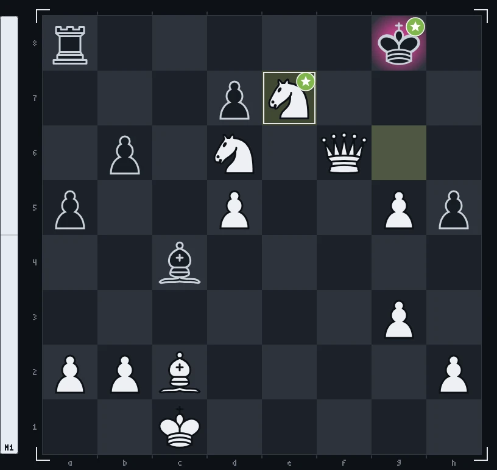
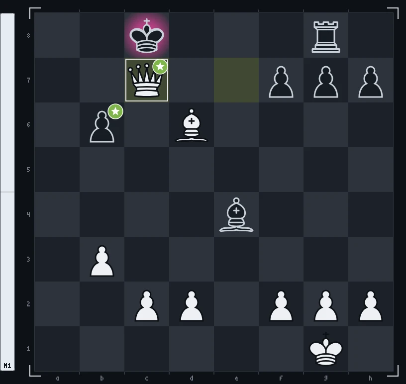

# Hall of games

Finished games of the open chess game on [@2md55nmxkw-arch's profile](https://github.com/2md55nmxkw-arch): visitors play White by opening an issue, stockfish answers for Black, and every move is graded the way chess.com does it. Best games first.

| record | game | |
| :-- | :-: | :-- |
| most brilliant moves | [2](#game-2) |  2 |
| fastest mate | [1](#game-1) | 26 moves |
| longest game | [2](#game-2) | 28 moves |

## Brilliant moves

| game | moves | by |
| :-: | :-- | :-- |
| [2](#game-2) | `17. Nc6` `26. Re7+` | [@2md55nmxkw-arch](https://github.com/2md55nmxkw-arch) |

## Best games

### Game 2

**1-0** · checkmate on move 28 · White: [@2md55nmxkw-arch](https://github.com/2md55nmxkw-arch) (26), [@MedakhmetAsylmurat](https://github.com/MedakhmetAsylmurat) (2) · Black: stockfish · 2026-11-10

 2 ·  23 ·  1 ·  1 ·  1

<picture><source media="(prefers-color-scheme: dark)" srcset="game-2.webp"><source media="(prefers-color-scheme: light)" srcset="game-2-light.webp"></picture>

1\. c4 Nc6 2. e4?! b6?! 3. d4 e5 4. d5 Nd4 5. Nc3 h5?! 6. Bd3 Bb7 7. Nf3 c6?! 8. Nxe5 Qf6 9. f4 Bc5 10. Be3 Nc2+ 11. Bxc2 Bxe3 12. g3 cxd5 13. exd5 Bc5?! 14. Qf3 a5?! 15. O-O-O Bd6 16. Rhe1 Qe7 **17. Nc6!!** Qxe1 18. Rxe1+ Kf8 19. Ne4 Ba6 20. Nxd6 f6 21. Ne5 g5 22. fxg5 Ke7 23. Nef7+ Kf8 24. Nxh8 Bxc4 25. Ng6+ Kg7 **26. Re7+!!** Nxe7 27. Qxf6+ Kg8 28. Nxe7# 1-0

### Game 1

**1-0** · checkmate on move 26 · White: [@2md55nmxkw-arch](https://github.com/2md55nmxkw-arch) (26) · Black: stockfish · 2026-11-10

 16 ·  3 ·  1 ·  1 ·  3 ·  2

<picture><source media="(prefers-color-scheme: dark)" srcset="game-1.webp"><source media="(prefers-color-scheme: light)" srcset="game-1-light.webp"></picture>

1\. Na3 d5 2. Rb1? e5 3. Nb5?! d4 4. Nxa7? Rxa7 5. e3 Rxa2 6. Bc4 Be6?! 7. Bxa2 Bxa2! 8. Ra1 Bc4 9. exd4 Bd5?! 10. Nf3 exd4 11. Qe2+?! Be6? 12. Ra8 Be7 13. Nxd4?! Qxd4 14. Rxb8+ Kd7?? 15. Qb5+ Kd6 16. O-O Qg4?? 17. b3 Qd4 18. Ba3+ c5 19. Re1 Bd5 20. Rc8 Qe4 21. Rxe4 Bxe4 22. Rxg8 Rxg8 23. Qxc5+ Kd7 24. Qxe7+ Kc8 25. Bd6 b6 26. Qc7# 1-0

## All games

| game | result | moves | !! | white | date |
| :-: | :-- | --: | --: | :-- | :-- |
| [2](#game-2) | 1-0 · checkmate | 28 | 2 | [@MedakhmetAsylmurat](https://github.com/MedakhmetAsylmurat), [@2md55nmxkw-arch](https://github.com/2md55nmxkw-arch) | 2026-11-10 |
| [1](#game-1) | 1-0 · checkmate | 26 |  | [@2md55nmxkw-arch](https://github.com/2md55nmxkw-arch) | 2026-11-10 |
